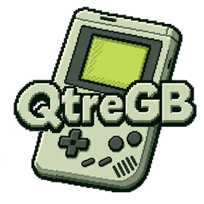
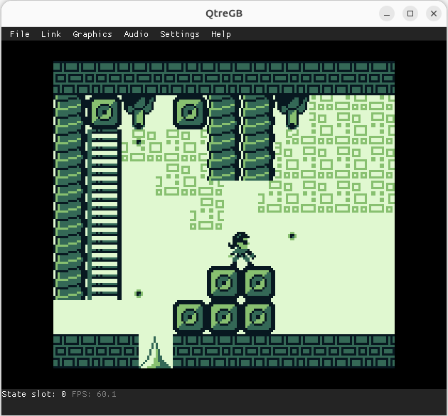

# QtreGB

Game Boy emulator in C++ using SDL2 and ImGui. The goal is to keep the core
independent from the GUI.

## Screenshot



Game imagery belongs to its respective author.

## License

QtreGB is free software licensed under **GPL-3.0-or-later**. See
[`LICENSE.txt`](LICENSE.txt).

The project-original visual assets, including the application icon, are
dedicated to the public domain under **CC0 1.0**. See
[`assets/LICENSE`](assets/LICENSE).

The QtreGB name and icon are unregistered trademarks. Their use is governed by
[`TRADEMARK.md`](TRADEMARK.md).

Third-party components and their licenses are listed in
[`THIRD_PARTY_NOTICES.md`](THIRD_PARTY_NOTICES.md).

## Build and run

```sh
make deps        # first checkout only: fetch/build ImGui and doctest
make -j"$(nproc)"
./build/QtreGB-GUI
```

You can pass a ROM directly:

```sh
./build/QtreGB-GUI game.gb
./build/QtreGB-GUI --version
./build/QtreGB-GUI --help
```

The desktop file uses `Exec=QtreGB %f`, so opening a `.gb` file from the file
manager starts a single-player game.

`Help → About QtreGB...` shows the application icon, version, license and
project links.

## Packages

```sh
make deb       # build/qtrebg_<version>_<arch>.deb
make appimage  # build/QtreGB-<version>-x86_64.AppImage
make release-assets  # both + SHA256SUMS + release notes
```

Release notes: [`packaging/RELEASE_NOTES_0.9.0.md`](packaging/RELEASE_NOTES_0.9.0.md).

The packaging scripts require `dpkg-deb` for the `.deb`; the AppImage script
downloads `linuxdeploy` and `appimagetool` into `temp/` when needed.

## Dependencies

QtreGB uses SDL2, Dear ImGui, ImGuiFileDialog and doctest. The Spanish UI
translation lives in `lang/es.po`; the language can be changed from
`Settings → Language`.
